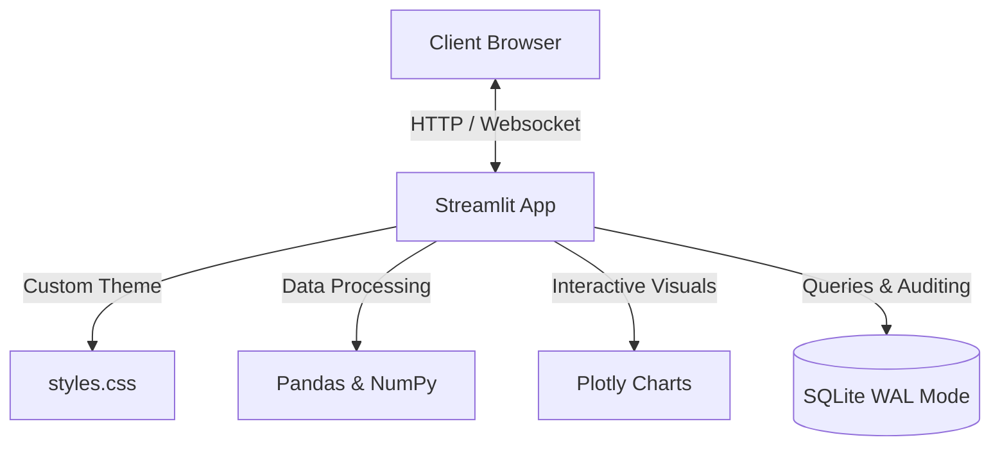

# 📊 LinhaMestre - Quality Control & Analytics Engine

[](https://python.org)
[](https://streamlit.io)
[](https://plotly.com)
[](https://docker.com)
[](https://kubernetes.io)
[](https://opensource.org/licenses/MIT)

LinhaMestre is an enterprise-grade quality control dashboard and stock management engine built in Python and Streamlit. Designed for operational and executive teams, it delivers real-time statistical quality analysis (Pareto, X-Bar, R/S Charts) with transactional security and robust auditing.

---

## 📖 Table of Contents
- [The "Why"](#the-why)
- [System Architecture](#system-architecture)
- [Database Schema](#database-schema)
- [Enterprise Features](#enterprise-features)
- [Built With](#built-with)
- [Quick Start](#quick-start)
- [Docker & Kubernetes Deployment](#docker--kubernetes-deployment)

---

## 💡 The "Why"
Industrial quality control (under ISO 8258 / ABNT NBR 5479 standards) requires reliable real-time visualization of sampling distributions and defect concentrations to prevent inventory waste. LinhaMestre bridges the gap by connecting stock tracking with statistical quality control charts, ensuring:
- **Zero-Trust Role Permissions:** Gradated access control (Operational, Supervisor, Manager, CEO, Admin) protecting critical audit assets.
- **ACID Transaction Safety:** Mandatory dual-writes to the operational database and audit trails.
- **Ultra-Responsive UI:** Custom glassmorphism CSS overlays with modular plotting pipelines.

---

## 🛠️ System Architecture



---

## 🗄️ Database Schema

```mermaid
erDiagram
    USERS ||--o{ PRODUCTS : "creates"
    USERS ||--o{ TASKS : "manages"
    USERS ||--o{ MESSAGES : "sends"
    USERS ||--o{ AUDIT_LOGS : "triggers"
    PRODUCTS ||--o{ QUALITY_CONTROL : "has"

    USERS {
        int id PK
        string username UNIQUE
        string password
        string name
        string email
        string access_level
        string salt
        timestamp created_at
    }

    PRODUCTS {
        int id PK
        string name
        string category
        int quantity
        int min_quantity
        string unit
        string location
        string supplier
        real cost
        real price
        string barcode
        date production_date
        date expiry_date
        string quality_status
        string notes
        int created_by FK
        timestamp created_at
        timestamp updated_at
    }

    AUDIT_LOGS {
        int id PK
        int user_id FK
        string action
        string details
        timestamp created_at
    }
```

---

## ✨ Enterprise Features
1. **Glassmorphic Business Intelligence UI:** Deep dark mode palettes, responsive sidebar inputs, and glowing indicators.
2. **Statistical Quality Charts:**
   - **X-Bar & R (Mean/Range):** Charts tracking sample ranges over control limits (UCL, LCL).
   - **X-Bar & S (Mean/Std Dev):** High-precision sample deviation analysis.
   - **I-MR (Individual & Moving Range):** Sequential metrics checking for continuous processes.
   - **Interactive Pareto Chart:** Multi-axis defect frequency bars matched against cumulative percentages.
   - **Histograms:** Capability indexes ($Cp$) calculated automatically based on product tolerances.
3. **Imutability Audit Log:** Automated background transaction hooks recording every product change, login, and user mutation.
4. **SQLite WAL Mode Integration:** Write-Ahead Logging active for maximum database read concurrency.

---

## 🧱 Built With
- **Frontend:** Streamlit Custom Style Injection, HTML5, Plotly
- **Data Engine:** Pandas, NumPy, Matplotlib, Seaborn
- **Backend/DB:** Python 3.11, SQLite3 (WAL Mode)
- **Infra:** Docker, Kubernetes (Manifests)

---

## 🚀 Quick Start

### 1. Install Dependencies
```bash
pip install -r requirements.txt
```

### 2. Run the Streamlit Application
```bash
streamlit run linhamestre_app.py
```
Open [http://localhost:8501](http://localhost:8501) in your browser.

---

## 🐳 Docker & Kubernetes Deployment

### Run with Docker Compose
Make sure Docker is installed. Spin up the container instantly:
```bash
docker-compose up --build
```
Access the application at [http://localhost:8501](http://localhost:8501).

### Deploy to Kubernetes Cluster
Apply the manifests to configure replication and routing:
```bash
kubectl apply -f k8s/deployment.yaml
kubectl apply -f k8s/service.yaml
```
The service is exposed as a NodePort on port `30851`.
